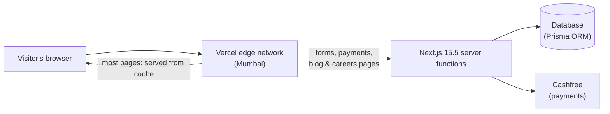
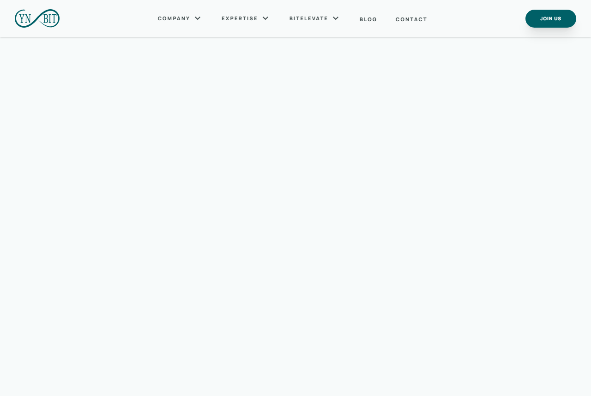
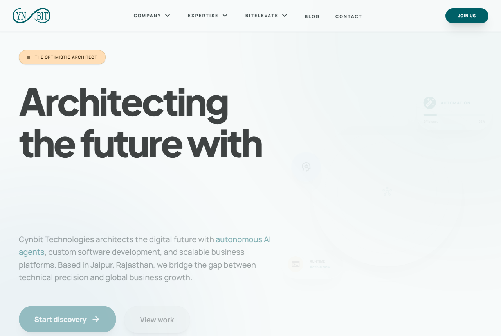
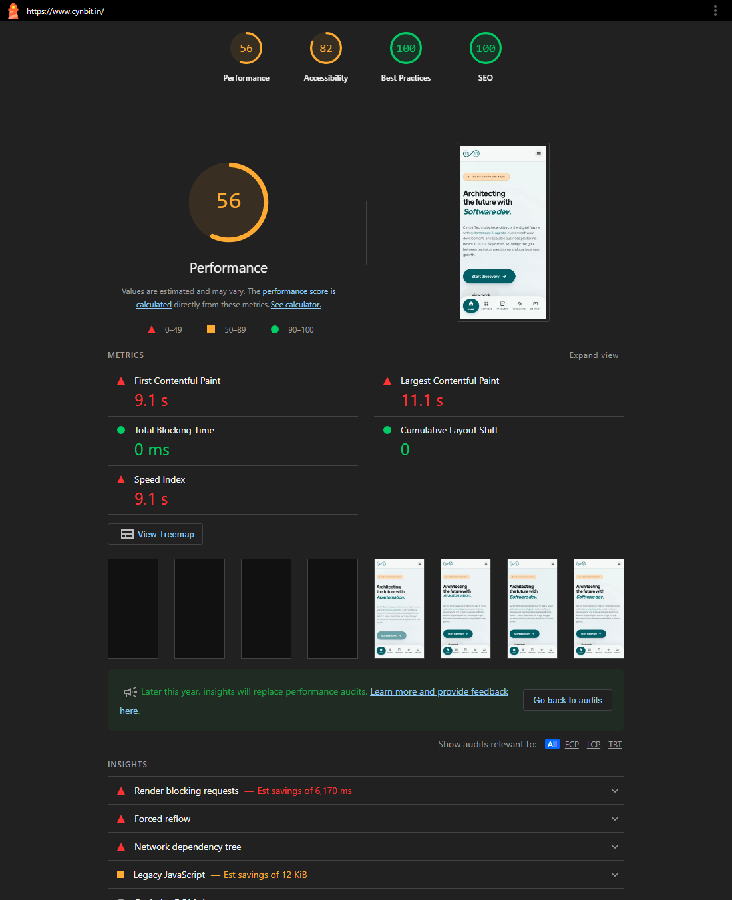
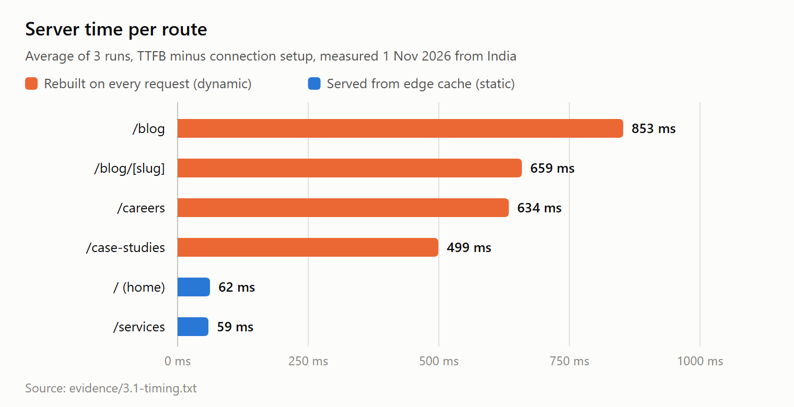
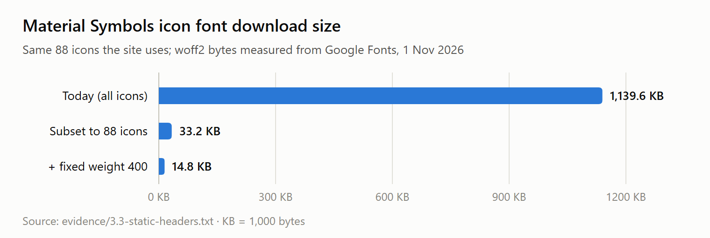

# Cynbit Backend Audit

A backend-focused review of **[www.cynbit.in](https://www.cynbit.in)**. I looked at how the site's backend behaves from the outside, found what could go wrong, and wrote code-level fixes for each problem.

> Backend Developer Intern assessment (Phase 2) · Kunal Chandrakar · 1–2 November 2026

---

## In one minute

- **What I did:** a passive, read-only audit of Cynbit's public website covering API behaviour, data handling, security, performance, error handling and architecture. Nothing was attacked, overloaded or logged into.
- **What I found:** **15 issues** (2 High · 6 Medium · 7 Low) and **12 things already done well**, each backed by saved evidence.
- **The three most important ones:**
  1. The web framework (Next.js) is **10 security patches behind**, and two of the missed patches fix High-severity bugs in exactly the feature this site relies on.
  2. Pages are built on the server in **30 ms** but then **hidden until JavaScript loads**, so on a phone the first content appears after **~9 seconds**.
  3. After paying for the BitElevate programme, the user's **login credentials are sent to the browser**, using a link that also ends up in Google Analytics.
- **What I'm proposing:** small, concrete fixes with code (most under half a day each) and a 3-stage roadmap.
- **Start here:** [`REPORT.md`](REPORT.md) is the full report. [`recommendations/`](recommendations/) has the fixes.

---

## How Cynbit's backend works (what I discovered)

From the outside, Cynbit's site looks like a normal company website. Underneath:



- **Hosting:** Vercel, Mumbai region. Most pages are pre-built and served from a cache in about 30 ms.
- **No traditional REST API.** Every backend action (contact form, lead forms, newsletter sign-up and the ₹3,999 BitElevate payment) is a **Next.js Server Action**: a server function the browser calls directly. I found all five by reading the site's public JavaScript.
- **Database:** IDs in the page data have the format Prisma generates by default, which points to **Prisma over a SQL database**.
- **Payments:** Cashfree. The price is set on the server, which is correct.
- **Email:** Microsoft 365.

---

## What I did, step by step

I followed a written plan ([`PLAN.md`](PLAN.md)) and committed after every step, so the **commit history shows the work in order**.

| Phase | What I did | Output |
|---|---|---|
| **0. Plan** | Wrote the method, a checklist, and strict passive-only rules | [`PLAN.md`](PLAN.md) |
| **1. Map the system** | Looked up DNS, email and TLS settings, read the response headers, `robots.txt`/`sitemap.xml` and the public JavaScript files, and recorded every network request a normal visit makes | [`evidence/1.*`](evidence/) |
| **2. API & data** | Examined the data the server sends to the browser, how errors are returned, caching and CORS, signs of rate limiting, and checked the framework version against GitHub's security advisories | [`evidence/2.*`](evidence/) |
| **3. Performance** | Timed static vs dynamic pages, ran Lighthouse (mobile + desktop), measured asset sizes and caching | [`evidence/3.*`](evidence/) |
| **4. Report** | Combined everything into findings with severity, confidence, evidence and impact | [`REPORT.md`](REPORT.md) |
| **5. Fixes** | Wrote a fix with code for every finding, a target architecture and a roadmap; tested the trickiest helpers | [`recommendations/`](recommendations/) |
| **6. Final checks** | Checked for secrets and personal data, checked every link, checked the GitHub rendering | this README |

Every observation was written down as soon as I saw it, with a timestamp, in [`notes/findings-log.md`](notes/findings-log.md).

---

## What I found

### Issues

| # | In plain words | Severity | Fix |
|---|---|---|---|
| [F-01](REPORT.md#f-01) | The Next.js version is 10 security patches old; 3 known vulnerabilities match how this site is built | **High** | [Upgrade + automatic updates](recommendations/dependencies.md) |
| [F-02](REPORT.md#f-02) | Every page is invisible (`opacity:0`) until JavaScript finishes loading, so mobile users wait ~9 s to see anything | **High** | [Animate without hiding content](recommendations/rendering-and-caching.md#1-dont-hide-server-rendered-html) |
| [F-03](REPORT.md#f-03) | After payment, login credentials are sent to the browser, and the payment link (with its token) is recorded by Google Analytics | Medium | [Payment webhook + email link](recommendations/payments.md) |
| [F-04](REPORT.md#f-04) | Anyone can script the forms or the payment-order endpoint: no CAPTCHA, length limits or visible rate limiting | Medium | [Validation + rate limit + CAPTCHA](recommendations/server-actions.md) |
| [F-05](REPORT.md#f-05) | No browser security headers, so the payment page can be embedded in another site (clickjacking) | Medium | [Security headers](recommendations/security-headers.md) |
| [F-06](REPORT.md#f-06) | Blog, careers and case-study pages are rebuilt on every visit (8–14× slower), and fake blog URLs trigger database lookups | Medium | [Caching (ISR)](recommendations/rendering-and-caching.md#2-cache-content-that-rarely-changes) |
| [F-07](REPORT.md#f-07) | A 1.1 MB icon font (66 % of the home page) is downloaded to show 88 icons; it can be 15 KB | Medium | [Subset the font](recommendations/rendering-and-caching.md#3-subset-the-icon-font) |
| [F-08](REPORT.md#f-08) | Email isn't protected against spoofing, so fake `@cynbit.in` offer letters would reach inboxes | Medium | [DKIM + DMARC](recommendations/email-and-privacy.md) |

Plus 7 Low-severity items (analytics before consent, redirect and sitemap issues, minor hardening, error format, structured-data errors, third-party images). See the [full table](REPORT.md#5-findings-summary).

### Evidence at a glance

**1. The page is hidden until JavaScript runs (F-02).** On the left is the server's HTML as delivered, with the scripts removed. Only the navigation bar shows, because the content is wrapped in `opacity:0`. On the right is the same page after JavaScript runs.

| Before JavaScript | After JavaScript |
|---|---|
|  |  |

**2. The result on mobile (Lighthouse).** Performance 56, first content at 9.1 s, and four blank frames in the filmstrip.



**3. Pages rebuilt on every visit are 8–14× slower (F-06).**



**4. One icon font could be ~77× smaller (F-07).**



<sub>The screenshots were taken with headless Chrome on 1–2 Nov 2026. The Lighthouse image renders the saved run behind the numbers in the report. The charts are drawn from the measured values in [`evidence/3.1-timing.txt`](evidence/3.1-timing.txt) and [`evidence/3.3-static-headers.txt`](evidence/3.3-static-headers.txt).</sub>

### Already done well
TLS 1.2/1.3 only · no secrets or source maps in the public code · the price is set on the server · payment status is checked with Cashfree on the server · the server sends only rendered content (no over-fetching, no personal data) · proper 404 pages with no stack traces · built-in CSRF protection on Server Actions · long-term caching and Brotli compression for static files · 30 ms response for cached pages. Full list: [REPORT §5](REPORT.md#positive-observations).

---

## How I'd fix it

| When | What | Effect |
|---|---|---|
| **Week 1** (quick wins) | Upgrade Next.js, stop hiding pages, shrink the icon font, add security headers, hide payment tokens from analytics, turn on DKIM | Closes both High issues; mobile first paint from ~9 s toward ~1–2 s (estimate); page size ~1.7 MB → ~0.6 MB |
| **Weeks 2–3** | Payment fulfilment through a signed Cashfree webhook, validation + rate limiting + CAPTCHA on all forms, caching for content pages | Closes the Medium issues; each paid order fulfilled exactly once |
| **Month 2** | Enforce DMARC, consent banner, monitoring and alerts, review of the logged-in areas | Long-term hardening |

Details and diagrams: [`recommendations/architecture.md`](recommendations/architecture.md).

---

## How to read this repo

**5 minutes:** this README → [REPORT §1 summary](REPORT.md#1-executive-summary) → [findings table](REPORT.md#5-findings-summary)
**20 minutes:** + [REPORT §3–4](REPORT.md#3-observed-architecture) (architecture, API, payload samples) → [payments fix](recommendations/payments.md) → [roadmap](recommendations/architecture.md)
**Deep dive:** any finding → its evidence file → its fix

| Path | What's inside |
|---|---|
| [`REPORT.md`](REPORT.md) | The full audit: architecture diagrams, API structure, **payload samples**, 15 detailed findings, positives, and what couldn't be checked |
| [`recommendations/`](recommendations/) | Fixes with TypeScript / Next.js code, one file per theme, plus target architecture and roadmap |
| [`recommendations/code/`](recommendations/code/) | Reusable helpers (payment webhook signature check, safe JSON-LD, typed action results) **with tests** |
| [`evidence/`](evidence/) | Raw outputs behind every claim (headers, DNS, TLS, JS analysis, timings, Lighthouse, advisories), numbered by step |
| [`notes/findings-log.md`](notes/findings-log.md) | Timestamped notes made during the audit |
| [`PLAN.md`](PLAN.md) | Method, rules and step checklist |

---

## Rules I followed

The assessment allowed **passive, authorized testing only**, so I:

- ✅ only made requests a normal browser makes, labelled with the User-Agent `cynbit-backend-audit; passive review` and spaced ≥ 2 s apart
- ✅ used public third-party sources (DNS lookups, certificate logs, GitHub's advisory database)
- ✅ read the JavaScript the site already sends to every visitor
- ❌ did **not** fuzz, inject payloads, brute-force, load-test, submit forms, replay payments or log in

Anything I could only deduce, not observe, is marked **Inferred** in the report.

## What I couldn't check

Logged-in areas (portal/admin sessions), server-side validation, rate limiting, whether a payment webhook exists, and database or monitoring setup. None of these can be seen without access or active testing. [REPORT §7](REPORT.md#7-what-passive-testing-could-not-verify) explains how to verify each one with access.

## Re-run the checks

```bash
# helper tests (Node ≥ 23 runs TypeScript directly, nothing to install)
node --test recommendations/code/lib.test.ts

# see the missing security headers yourself
curl -sI https://www.cynbit.in/ | grep -iE 'content-security|x-frame|x-content-type|referrer-policy|permissions-policy'

# see the hidden page content
curl -s https://www.cynbit.in/ | grep -o 'style="opacity:0[^"]*"'

# reproduce the performance numbers
npx lighthouse@12.8.2 https://www.cynbit.in/ --only-categories=performance --view
```
