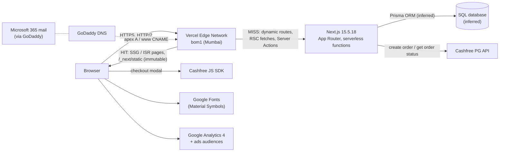
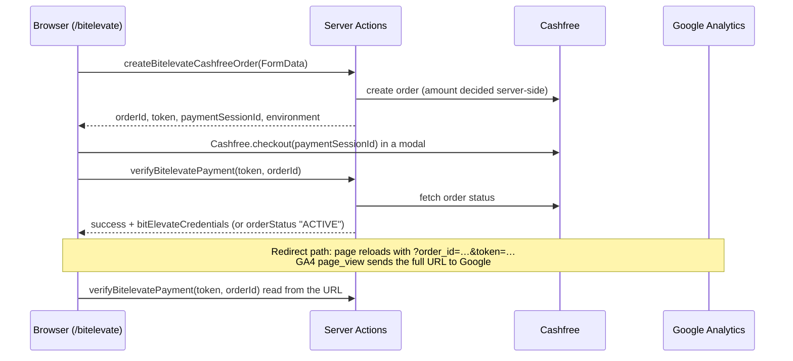

# Cynbit Backend Technical Audit

**Target:** https://www.cynbit.in (Cynbit Technologies)
**Author:** Kunal Chandrakar, Backend Developer Intern assessment (Phase 2)
**Date:** 1–2 November 2026
**Method:** passive, unauthenticated observation only (see §2)

---

## 1. Executive summary

Cynbit's site is a **Next.js 15.5 App Router application on Vercel (Mumbai edge)**. It has **no REST API**: all backend writes go through **five public Next.js Server Actions** (contact, service lead, newsletter, and a two-step Cashfree payment flow for the ₹3,999 BitElevate programme). Data is most likely stored with **Prisma over a SQL database**.

The foundations are good: TLS 1.2/1.3 only, no secrets or source maps in the client, server-side pricing and payment-status checks, no over-fetching or PII in server-component payloads, and a 30 ms edge response for static pages.

The main risks are **operational and architectural rather than one dramatic hole**:

1. **Next.js is 10 security patches behind** (15.5.18 vs 15.5.28). Two High DoS advisories and one Medium endpoint-disclosure advisory match this exact architecture.
2. **Server-rendered pages are hidden until JavaScript runs.** The whole `<main>` ships with `opacity:0`, so mobile first paint is **9.1 s** even though the server answers in **30 ms**.
3. **The payment completion flow returns login credentials to the browser** from a URL carrying `token` + `order_id`, which Google Analytics records. Fulfilment appears to be client-triggered.
4. **Public Server Actions have no visible abuse controls** (no CAPTCHA, no length limits, no rate-limit signals), and **no HTTP security headers** are set at all.
5. **Rarely changing content is rendered per request** (8–14× slower than static pages), and a **1.1 MB icon font is 66 % of the home page's weight**.

Most fixes are small: a patch-level upgrade, one animation prop, one font URL, one `headers()` block, and per-route caching settings. Ready-to-use code is in [`recommendations/`](recommendations/).

| Severity | Count |
|---|---|
| High | 2 |
| Medium | 6 |
| Low | 7 |
| Positive observations | 12 |

---

## 2. Scope and methodology

**In scope:** `www.cynbit.in` and the apex `cynbit.in`, plus everything those pages load or call.
**Out of scope:** `portal.`, `support.` and `bitelevate.cynbit.in` (found in Certificate Transparency logs but not linked from the public site), and any authenticated area.

**Rules of engagement** (full table in [`PLAN.md`](PLAN.md#rules-of-engagement-passive-only)):
- Only requests a normal browser makes, identified with the User-Agent `cynbit-backend-audit; passive review`, spaced ≥ 2 s apart.
- **No** fuzzing, payloads, brute force, rate-limit testing, form submissions, or replay of payment calls.
- Third-party passive sources: Google DNS-over-HTTPS, Cert Spotter (CT logs), GitHub Advisory Database.
- Public JS bundles were read to map the backend surface; nothing was executed against Cynbit.
- Anything that can't be observed from outside is labelled **Inferred**, never Confirmed.

**Tools:** `curl` 8.21, `openssl` 3.5, Lighthouse 12.8.2 (headless Chrome), browser DevTools / Resource Timing API, `gh` (GitHub Advisory API).

**Evidence:** every finding links to raw output in [`evidence/`](evidence/). Observations were logged as they happened in [`notes/findings-log.md`](notes/findings-log.md). Commit history follows the plan step by step.

**Severity scale:** **High**: realistic, direct impact on users or the business. **Medium**: a missing control with realistic impact. **Low**: hardening. Confidence is either **Confirmed** (observed) or **Inferred** (deduced from client code or headers, not provable without server access).

---

## 3. Observed architecture

| Layer | Observation | Evidence |
|---|---|---|
| DNS | GoDaddy (`domaincontrol.com`); `www` CNAME → Vercel; apex A → Vercel anycast | [1.1](evidence/1.1-dns.txt) |
| Edge / hosting | Vercel, region `bom1`; TLS 1.2/1.3, Let's Encrypt 90-day certs | [1.3](evidence/1.3-tls.txt), [1.4](evidence/1.4-headers.txt) |
| Framework | Next.js **15.5.18** (`window.next.version`), App Router, route group `(marketing)`, React 19.2 canary (vendored) | [1.6](evidence/1.6-bundle-notes.md), [2.7](evidence/2.7-advisories.md) |
| Rendering | SSG: `/`, `/services`, `/bitelevate`, `/story`, `/team`, `/impact`, `/products`. ISR: `/contact`. **Dynamic:** `/careers`, `/blog`, `/blog/[slug]`, `/case-studies`, `/sitemap.xml` | [1.4](evidence/1.4-headers.txt), [1.7](evidence/1.7-endpoints.md) |
| Backend interface | No `/api/*` routes; **5 Server Actions** + RSC GETs | [1.6](evidence/1.6-bundle-notes.md), [2.1](evidence/2.1-payloads.md) |
| Persistence | CUID primary keys (`cmp6kjrcl…`), Prisma's `@default(cuid())`; content bulk-seeded on 2026-05-20 | [2.1](evidence/2.1-payloads.md) |
| Payments | Cashfree PG (production mode), order + verify via Server Actions | [1.6](evidence/1.6-bundle-notes.md) |
| Email | Microsoft 365; SPF correct and strict; DMARC `p=none`; no M365 DKIM selectors | [1.1](evidence/1.1-dns.txt) |
| Third parties | Google Fonts, GA4 (`G-LK6CQWCWX0`) with advertising features, Cashfree SDK, `i.pravatar.cc`, Unsplash, transparenttextures.com | [1.7](evidence/1.7-endpoints.md) |

---

## 4. API structure and payloads

### 4.1 Two kinds of backend endpoint

| Kind | Request | Response | Used for |
|---|---|---|---|
| **RSC GET** | `GET /<route>` with header `RSC: 1` (or `?_rsc=`) | `text/x-component` flight data, 8–56 KB | client navigation and background prefetch |
| **Server Action** | `POST /<route>` with header `Next-Action: <id>` and a FormData body | RSC flight data with the action's return value | every write |

Server Actions are **ordinary public HTTP endpoints**. Their IDs and function names ship in the client bundle, so anyone can call them directly without the UI. They need the same validation, rate limiting and authorisation as a REST API.

### 4.2 Server Actions inventory

| Action | Page | Input (from client code) | Client-side checks | Auth |
|---|---|---|---|---|
| `submitInquiry` | `/contact` | `fullName`, `email`, `company`, `industry`, `message` | `required` ×3, `type=email` | none |
| `submitServiceLead` | `/products`, `/bitelevate/paths` | `fullName`, `email`, `company`, `message` / `currentLevel`, `focusAreas`, `primaryGoal`, `agreedToTerms` | `required` | none |
| `subscribeToNewsletter` | footer (all pages), `/blog` | `email` | `type=email` | none |
| `createBitelevateCashfreeOrder` | `/bitelevate` | `fullName`, `email`, `phone`, `university`, `track`, `duration`, `ambitions`, `referralName` (**no amount** ✔) | `required` ×7 | none |
| `verifyBitelevatePayment` | `/bitelevate` + return URL | `(token, orderId)` | n/a | `token` |

No length limits, no schema library, no CAPTCHA/honeypot on any of them.

### 4.3 Payment flow (reconstructed from client code)

Good: the price is never sent by the client, and success is decided by querying Cashfree server-side (`orderStatus: "ACTIVE"` is a Cashfree status). Concerns are in [F-03](#f-03).

### 4.4 Payload quality
- **No over-fetching.** DB records reach the browser only as rendered elements, with no row objects, timestamps, author fields or flags ([2.1](evidence/2.1-payloads.md)).
- **No PII** in any payload; DB IDs appear only as React keys.
- **Errors:** correct `404` status for unknown pages and slugs, custom page, no stack traces. But `/api/*` also returns the HTML 404 page rather than a machine-readable error ([2.3](evidence/2.3-errors.txt)).
- **Response contract:** Server Actions return ad-hoc objects (`{success, error, orderStatus, …}`) instead of one typed result envelope.

---

## 5. Findings summary

| ID | Finding | Category | Severity | Confidence | Effort |
|---|---|---|---|---|---|
| [F-01](#f-01) | Next.js 15.5.18 is 10 security patches behind; 3 advisories match this architecture | Security | **High** | Confirmed version · advisory impact | S |
| [F-02](#f-02) | Server-rendered page is hidden (`opacity:0`) until hydration; mobile FCP 9.1 s | Performance / Architecture | **High** | Confirmed | S |
| [F-03](#f-03) | Payment completion returns login credentials from a URL token that GA4 records; client-triggered fulfilment | Authentication / Data handling | Medium | Confirmed design · Inferred exploitability | M |
| [F-04](#f-04) | Public Server Actions have no visible abuse controls (CAPTCHA, length limits, rate limiting) | Data validation / Security | Medium | Inferred | M |
| [F-05](#f-05) | No HTTP security headers (CSP, frame protection, nosniff, Referrer/Permissions-Policy) | Security | Medium | Confirmed | S–M |
| [F-06](#f-06) | Rarely changing pages rendered per request; random slugs force uncached lookups | Architecture / Performance | Medium | Confirmed | S |
| [F-07](#f-07) | 1.1 MB render-blocking icon font for 88 icons (66 % of page weight) | Performance | Medium | Confirmed | S |
| [F-08](#f-08) | DMARC `p=none` with no reporting; Microsoft 365 DKIM not published | Security (email) | Medium | Confirmed | S |
| [F-09](#f-09) | GA4 with advertising features fires before any consent | Data handling / Privacy | Low | Confirmed | S |
| [F-10](#f-10) | Temporary, uncached apex redirect; sitemap and metadata point at the non-canonical host; `lastmod` = request time | Architecture / Data correctness | Low | Confirmed | S |
| [F-11](#f-11) | Disclosure and transport hardening: `X-Powered-By`, HSTS without subdomains, no CAA, no `security.txt` | Security | Low | Confirmed | S |
| [F-12](#f-12) | No machine-readable error contract (`/api/*` → HTML 404, ad-hoc action results) | Error handling | Low | Confirmed | S |
| [F-13](#f-13) | JSON-LD built from DB fields without `<` escaping | Security (hardening) | Low | Confirmed pattern | S |
| [F-14](#f-14) | Structured data lists the ₹3,999 participant fee as a job `baseSalary` | Data correctness | Low | Confirmed | S |
| [F-15](#f-15) | Third-party placeholder images in production; `max-age=0` on images and `public/` files | Performance / Privacy | Low | Confirmed | S |

Effort: **S** < ½ day · **M** 1–3 days · **L** > 3 days.

### Positive observations

| # | What's done well | Evidence |
|---|---|---|
| P-1 | TLS 1.0/1.1 rejected; TLS 1.2/1.3 with AEAD ciphers only | [1.3](evidence/1.3-tls.txt) |
| P-2 | SPF correct and strict (`-all`; GoDaddy chain includes Microsoft 365) | [1.1](evidence/1.1-dns.txt) |
| P-3 | No secrets, API keys or source maps in client bundles | [1.6](evidence/1.6-bundle-notes.md) |
| P-4 | Payment amount decided server-side (no amount field in the order form) | [1.6](evidence/1.6-bundle-notes.md) |
| P-5 | Payment success checked against Cashfree server-side, not trusted from the client | [1.6](evidence/1.6-bundle-notes.md) |
| P-6 | Server Components send rendered output only: no over-fetching, no PII | [2.1](evidence/2.1-payloads.md) |
| P-7 | Correct 404 status codes, custom error page, no stack traces, `noindex` on 404 | [2.3](evidence/2.3-errors.txt) |
| P-8 | Server Actions get Next.js's built-in Origin/Host CSRF check | [2.4](evidence/2.4-cors-caching-ratelimit.md) |
| P-9 | `Vary` on RSC headers prevents HTML/RSC cache mix-ups | [2.4](evidence/2.4-cors-caching-ratelimit.md) |
| P-10 | Static assets: `immutable` 1-year cache, Brotli, HTTP/2 | [3.3](evidence/3.3-static-headers.txt) |
| P-11 | Static pages served from the edge with a **30 ms** server response | [3.2](evidence/3.2-lighthouse.md) |
| P-12 | Lighthouse Best Practices 100 and SEO 100; TBT 0 ms; CLS 0 | [3.2](evidence/3.2-lighthouse.md) |
