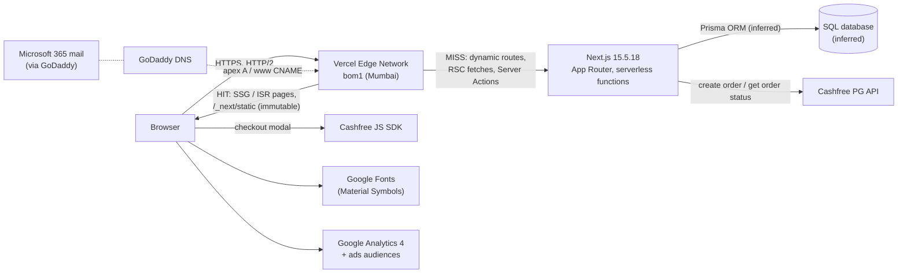
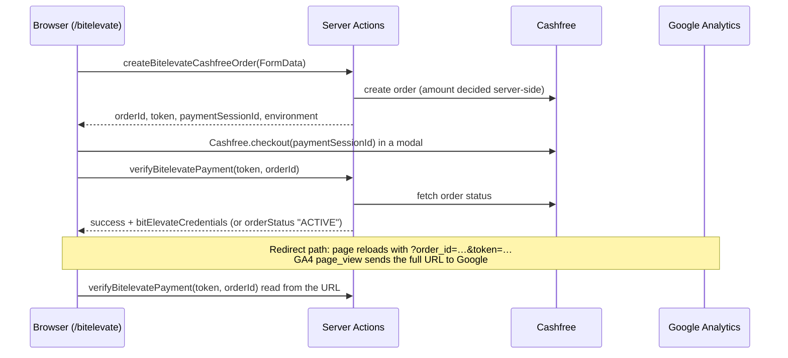

# Cynbit Backend Technical Audit

**Target:** https://www.cynbit.in (Cynbit Technologies)
**Author:** Kunal Chandrakar, Backend Developer Intern assessment (Phase 2)
**Date:** 1–2 November 2026
**Method:** passive, unauthenticated observation only (see §2)

---

## 1. Executive summary

Cynbit's site is a **Next.js 15.5 App Router application on Vercel (Mumbai edge)**. It has **no REST API**: all backend writes go through **five public Next.js Server Actions** (contact, service lead, newsletter, and a two-step Cashfree payment flow for the ₹3,999 BitElevate programme). Data is most likely stored with **Prisma over a SQL database**.

The foundations are good: TLS 1.2/1.3 only, no secrets or source maps in the client, server-side pricing and payment-status checks, no over-fetching or PII in server-component payloads, and a 30 ms edge response for static pages.

The main risks are **operational and architectural rather than one dramatic hole**:

1. **Next.js is 10 security patches behind** (15.5.18 vs 15.5.28). Two High DoS advisories and one Medium endpoint-disclosure advisory match this exact architecture.
2. **Server-rendered pages are hidden until JavaScript runs.** The whole `<main>` ships with `opacity:0`, so mobile first paint is **9.1 s** even though the server answers in **30 ms**.
3. **The payment completion flow returns login credentials to the browser** from a URL carrying `token` + `order_id`, which Google Analytics records. Fulfilment appears to be client-triggered.
4. **Public Server Actions have no visible abuse controls** (no CAPTCHA, no length limits, no rate-limit signals), and **no HTTP security headers** are set at all.
5. **Rarely changing content is rendered per request** (8–14× slower than static pages), and a **1.1 MB icon font is 66 % of the home page's weight**.

Most fixes are small: a patch-level upgrade, one animation prop, one font URL, one `headers()` block, and per-route caching settings. Ready-to-use code is in [`recommendations/`](recommendations/).

| Severity | Count |
|---|---|
| High | 2 |
| Medium | 6 |
| Low | 7 |
| Positive observations | 12 |

---

## 2. Scope and methodology

**In scope:** `www.cynbit.in` and the apex `cynbit.in`, plus everything those pages load or call.
**Out of scope:** `portal.`, `support.` and `bitelevate.cynbit.in` (found in Certificate Transparency logs but not linked from the public site), and any authenticated area.

**Rules of engagement** (full table in [`PLAN.md`](PLAN.md#rules-of-engagement-passive-only)):
- Only requests a normal browser makes, identified with the User-Agent `cynbit-backend-audit; passive review`, spaced ≥ 2 s apart.
- **No** fuzzing, payloads, brute force, rate-limit testing, form submissions, or replay of payment calls.
- Third-party passive sources: Google DNS-over-HTTPS, Cert Spotter (CT logs), GitHub Advisory Database.
- Public JS bundles were read to map the backend surface; nothing was executed against Cynbit.
- Anything that can't be observed from outside is labelled **Inferred**, never Confirmed.

**Tools:** `curl` 8.21, `openssl` 3.5, Lighthouse 12.8.2 (headless Chrome), browser DevTools / Resource Timing API, `gh` (GitHub Advisory API).

**Evidence:** every finding links to raw output in [`evidence/`](evidence/). Observations were logged as they happened in [`notes/findings-log.md`](notes/findings-log.md). Commit history follows the plan step by step.

**Severity scale:** **High**: realistic, direct impact on users or the business. **Medium**: a missing control with realistic impact. **Low**: hardening. Confidence is either **Confirmed** (observed) or **Inferred** (deduced from client code or headers, not provable without server access).

---

## 3. Observed architecture



| Layer | Observation | Evidence |
|---|---|---|
| DNS | GoDaddy (`domaincontrol.com`); `www` CNAME → Vercel; apex A → Vercel anycast | [1.1](evidence/1.1-dns.txt) |
| Edge / hosting | Vercel, region `bom1`; TLS 1.2/1.3, Let's Encrypt 90-day certs | [1.3](evidence/1.3-tls.txt), [1.4](evidence/1.4-headers.txt) |
| Framework | Next.js **15.5.18** (`window.next.version`), App Router, route group `(marketing)`, React 19.2 canary (vendored) | [1.6](evidence/1.6-bundle-notes.md), [2.7](evidence/2.7-advisories.md) |
| Rendering | SSG: `/`, `/services`, `/bitelevate`, `/story`, `/team`, `/impact`, `/products`. ISR: `/contact`. **Dynamic:** `/careers`, `/blog`, `/blog/[slug]`, `/case-studies`, `/sitemap.xml` | [1.4](evidence/1.4-headers.txt), [1.7](evidence/1.7-endpoints.md) |
| Backend interface | No `/api/*` routes; **5 Server Actions** + RSC GETs | [1.6](evidence/1.6-bundle-notes.md), [2.1](evidence/2.1-payloads.md) |
| Persistence | CUID primary keys (`cmp6kjrcl…`), Prisma's `@default(cuid())`; content bulk-seeded on 2026-05-20 | [2.1](evidence/2.1-payloads.md) |
| Payments | Cashfree PG (production mode), order + verify via Server Actions | [1.6](evidence/1.6-bundle-notes.md) |
| Email | Microsoft 365; SPF correct and strict; DMARC `p=none`; no M365 DKIM selectors | [1.1](evidence/1.1-dns.txt) |
| Third parties | Google Fonts, GA4 (`G-LK6CQWCWX0`) with advertising features, Cashfree SDK, `i.pravatar.cc`, Unsplash, transparenttextures.com | [1.7](evidence/1.7-endpoints.md) |

---

## 4. API structure and payloads

### 4.1 Two kinds of backend endpoint

| Kind | Request | Response | Used for |
|---|---|---|---|
| **RSC GET** | `GET /<route>` with header `RSC: 1` (or `?_rsc=`) | `text/x-component` flight data, 8–56 KB | client navigation and background prefetch |
| **Server Action** | `POST /<route>` with header `Next-Action: <id>` and a FormData body | RSC flight data with the action's return value | every write |

Server Actions are **ordinary public HTTP endpoints**. Their IDs and function names ship in the client bundle, so anyone can call them directly without the UI. They need the same validation, rate limiting and authorisation as a REST API.

### 4.2 Server Actions inventory

| Action | Page | Input (from client code) | Client-side checks | Auth |
|---|---|---|---|---|
| `submitInquiry` | `/contact` | `fullName`, `email`, `company`, `industry`, `message` | `required` ×3, `type=email` | none |
| `submitServiceLead` | `/products`, `/bitelevate/paths` | `fullName`, `email`, `company`, `message` / `currentLevel`, `focusAreas`, `primaryGoal`, `agreedToTerms` | `required` | none |
| `subscribeToNewsletter` | footer (all pages), `/blog` | `email` | `type=email` | none |
| `createBitelevateCashfreeOrder` | `/bitelevate` | `fullName`, `email`, `phone`, `university`, `track`, `duration`, `ambitions`, `referralName` (**no amount** ✔) | `required` ×7 | none |
| `verifyBitelevatePayment` | `/bitelevate` + return URL | `(token, orderId)` | n/a | `token` |

No length limits, no schema library, no CAPTCHA/honeypot on any of them.

### 4.3 Payment flow (reconstructed from client code)



Good: the price is never sent by the client, and success is decided by querying Cashfree server-side (`orderStatus: "ACTIVE"` is a Cashfree status). Concerns are in [F-03](#f-03).

### 4.4 Payload quality
- **No over-fetching.** DB records reach the browser only as rendered elements, with no row objects, timestamps, author fields or flags ([2.1](evidence/2.1-payloads.md)).
- **No PII** in any payload; DB IDs appear only as React keys.
- **Errors:** correct `404` status for unknown pages and slugs, custom page, no stack traces. But `/api/*` also returns the HTML 404 page rather than a machine-readable error ([2.3](evidence/2.3-errors.txt)).
- **Response contract:** Server Actions return ad-hoc objects (`{success, error, orderStatus, …}`) instead of one typed result envelope.

### 4.5 Payload samples

Real excerpts, trimmed with `…`. Samples A–B were captured on 2026-11-01 with one normal `GET`. Samples C–E come from the public client bundle. **No Server Action was sent**, because that would create records.

**A. RSC GET: response headers** (`GET /blog` with `RSC: 1`, the request the browser makes when prefetching or navigating)
```http
HTTP/1.1 200 OK
Content-Type: text/x-component
Cache-Control: private, no-cache, no-store, max-age=0, must-revalidate
Vary: rsc, next-router-state-tree, next-router-prefetch, next-router-segment-prefetch
X-Matched-Path: /blog.rsc
X-Vercel-Cache: MISS
```
The `no-store` + `MISS` combination means every `/blog` navigation or prefetch is a fresh serverless render ([F-06](#f-06)).

**B. RSC GET: body** (React Flight format: one row per line, `id:payload`)
```text
1:"$Sreact.fragment"
2:I[9766,[],""]
3:I[50960,["2619","static/chunks/2619-04bc32f026a0d946.js", …],"default"]      ← client-component references
…
["$","$L16","cmp6kjrcl00039cexi862ilf7",{"delay":0,"children":
  ["$","$L17",null,{"href":"/blog/ai-digital-marketing-revolution","children":
    ["$","article",null,{"className":"group cursor-pointer flex flex-col h-full","children":[
      ["$","$L1b",null,{"alt":"How AI is Revolutionizing Digital Marketing in 2026",
                        "src":"https://images.unsplash.com/photo-1485827404703-…","loading":"lazy", …}], …
```
What this shows:
- Each blog post arrives as **rendered elements** (`article`, `href`, `alt`, `src`), not as a database row. There's no `createdAt`, `authorId`, `status` or `email`, so **no over-fetching**.
- The only trace of the database is the React `key` `cmp6kjrcl00039cexi862ilf7`, a CUID, which points to Prisma `@default(cuid())`.
- The size is 29.7 KB for `/blog`, mostly Tailwind class strings. All five sampled routes are measured in [evidence 2.1](evidence/2.1-payloads.md).

**C. Server Action: request shape** (framework code from the public bundle; this is what every form submission sends)
```js
fetch(e.canonicalUrl, {                       // POST to the page's own URL, e.g. https://www.cynbit.in/contact
  method: "POST",
  headers: {
    Accept: RSC_CONTENT_TYPE_HEADER,          // "text/x-component"
    [ACTION_HEADER]: p,                       // "next-action": <action id from the bundle, e.g. 40247b…>
    [NEXT_ROUTER_STATE_TREE_HEADER]: …,       // current route tree
  },
  body: v,                                    // the encoded arguments (FormData for the forms)
});
if ("1" === res.headers.get(NEXT_ACTION_NOT_FOUND_HEADER)) throw new UnrecognizedActionError(…)
```
Calling an action takes only the page URL, a `next-action` header with an ID that's in the public JS, and a form body, so it can be scripted without the UI ([F-04](#f-04)).

**D. Server Action: response fields the client reads** (from each page's bundle)
```js
// /bitelevate: createBitelevateCashfreeOrder(FormData)
{ success, orderId, token, paymentSessionId, environment, error }
// /bitelevate: verifyBitelevatePayment(token, orderId)
{ success, bitElevateCredentials, orderStatus /* "ACTIVE" = unpaid */, error }
// /contact: submitInquiry(FormData)
{ success }
```

**E. How the contact form handles that response** (minified client code)
```js
a = new FormData(e.currentTarget), r = await x(a);   // x = submitInquiry
t(!1), r.success ? i(!0) : n("Something went wrong. Please try again or email us directly.")
```
Only `success` is read. Any failure, whether a validation error, a server error or (later) a rate limit, shows the same generic message, so users can't correct their input and logs can't tell causes apart. This is the concrete case behind [F-12](#f-12).

---

## 5. Findings summary

| ID | Finding | Category | Severity | Confidence | Effort |
|---|---|---|---|---|---|
| [F-01](#f-01) | Next.js 15.5.18 is 10 security patches behind; 3 advisories match this architecture | Security | **High** | Confirmed version · advisory impact | S |
| [F-02](#f-02) | Server-rendered page is hidden (`opacity:0`) until hydration; mobile FCP 9.1 s | Performance / Architecture | **High** | Confirmed | S |
| [F-03](#f-03) | Payment completion returns login credentials from a URL token that GA4 records; client-triggered fulfilment | Authentication / Data handling | Medium | Confirmed design · Inferred exploitability | M |
| [F-04](#f-04) | Public Server Actions have no visible abuse controls (CAPTCHA, length limits, rate limiting) | Data validation / Security | Medium | Inferred | M |
| [F-05](#f-05) | No HTTP security headers (CSP, frame protection, nosniff, Referrer/Permissions-Policy) | Security | Medium | Confirmed | S–M |
| [F-06](#f-06) | Rarely changing pages rendered per request; random slugs force uncached lookups | Architecture / Performance | Medium | Confirmed | S |
| [F-07](#f-07) | 1.1 MB render-blocking icon font for 88 icons (66 % of page weight) | Performance | Medium | Confirmed | S |
| [F-08](#f-08) | DMARC `p=none` with no reporting; Microsoft 365 DKIM not published | Security (email) | Medium | Confirmed | S |
| [F-09](#f-09) | GA4 with advertising features fires before any consent | Data handling / Privacy | Low | Confirmed | S |
| [F-10](#f-10) | Temporary, uncached apex redirect; sitemap and metadata point at the non-canonical host; `lastmod` = request time | Architecture / Data correctness | Low | Confirmed | S |
| [F-11](#f-11) | Disclosure and transport hardening: `X-Powered-By`, HSTS without subdomains, no CAA, no `security.txt` | Security | Low | Confirmed | S |
| [F-12](#f-12) | No machine-readable error contract (`/api/*` → HTML 404, ad-hoc action results) | Error handling | Low | Confirmed | S |
| [F-13](#f-13) | JSON-LD built from DB fields without `<` escaping | Security (hardening) | Low | Confirmed pattern | S |
| [F-14](#f-14) | Structured data lists the ₹3,999 participant fee as a job `baseSalary` | Data correctness | Low | Confirmed | S |
| [F-15](#f-15) | Third-party placeholder images in production; `max-age=0` on images and `public/` files | Performance / Privacy | Low | Confirmed | S |

Effort: **S** < ½ day · **M** 1–3 days · **L** > 3 days.

### Positive observations

| # | What's done well | Evidence |
|---|---|---|
| P-1 | TLS 1.0/1.1 rejected; TLS 1.2/1.3 with AEAD ciphers only | [1.3](evidence/1.3-tls.txt) |
| P-2 | SPF correct and strict (`-all`; GoDaddy chain includes Microsoft 365) | [1.1](evidence/1.1-dns.txt) |
| P-3 | No secrets, API keys or source maps in client bundles | [1.6](evidence/1.6-bundle-notes.md) |
| P-4 | Payment amount decided server-side (no amount field in the order form) | [1.6](evidence/1.6-bundle-notes.md) |
| P-5 | Payment success checked against Cashfree server-side, not trusted from the client | [1.6](evidence/1.6-bundle-notes.md) |
| P-6 | Server Components send rendered output only: no over-fetching, no PII | [2.1](evidence/2.1-payloads.md) |
| P-7 | Correct 404 status codes, custom error page, no stack traces, `noindex` on 404 | [2.3](evidence/2.3-errors.txt) |
| P-8 | Server Actions get Next.js's built-in Origin/Host CSRF check | [2.4](evidence/2.4-cors-caching-ratelimit.md) |
| P-9 | `Vary` on RSC headers prevents HTML/RSC cache mix-ups | [2.4](evidence/2.4-cors-caching-ratelimit.md) |
| P-10 | Static assets: `immutable` 1-year cache, Brotli, HTTP/2 | [3.3](evidence/3.3-static-headers.txt) |
| P-11 | Static pages served from the edge with a **30 ms** server response | [3.2](evidence/3.2-lighthouse.md) |
| P-12 | Lighthouse Best Practices 100 and SEO 100; TBT 0 ms; CLS 0 | [3.2](evidence/3.2-lighthouse.md) |

---

## 6. Detailed findings

<a id="f-01"></a>
### F-01: Next.js 15.5.18 is 10 security patches behind
**Category:** Security · **Severity:** High · **Confidence:** Confirmed version, impact per advisory (not exploited) · **Effort:** S

**Evidence:** [`evidence/2.7-advisories.md`](evidence/2.7-advisories.md)
```
window.next.version          → "15.5.18"   (appDir: true)
GitHub Advisory DB, affects=next@15.5.18 → 14 advisories; latest 15.5.x = 15.5.28
Applies here (App Router + Server Actions):
  GHSA-p3m5-59mp-jv5r  High    DoS in App Router using Server Actions            fixed 15.5.28
  GHSA-m99w-x7hq-7vfj  High    DoS in App Router using Server Actions            fixed 15.5.21
  GHSA-955p-x3mx-jcvp  Medium  Disclosure of internal Server Function endpoints  fixed 15.5.21
```
The other 11 advisories were checked one by one. Five don't apply on Vercel (Windows hosting, custom server, self-hosted cache, catch-all route, Vercel-exempt image DoS). Five depend on code not visible from outside. The image-optimizer RCEs are probably not exploitable because Vercel serves `/_next/image` itself.

**Impact:** Two High-severity DoS issues target exactly the feature this site depends on for every form and payment. The advisories say there is **no workaround besides upgrading**. Being 10 patch releases behind also suggests there is no process for applying security updates.

**Recommendation:** upgrade `next` to **15.5.28** (patch release, no breaking changes) and turn on Dependabot/Renovate security updates with a CI build gate. → [`recommendations/dependencies.md`](recommendations/dependencies.md)

---

<a id="f-02"></a>
### F-02: Server-rendered page is hidden until JavaScript hydrates
**Category:** Performance / Architecture · **Severity:** High · **Confidence:** Confirmed · **Effort:** S

**Evidence:** [`evidence/3.2-lighthouse.md`](evidence/3.2-lighthouse.md)
```html
<main class="flex-grow"><div style="opacity:0;transform:translateY(10px)"> … whole page … </div></main>
```
| Lighthouse (home) | Mobile | Desktop |
|---|---|---|
| Server response | 30 ms | 30 ms |
| First Contentful Paint | **9.1 s** | 0.9 s |
| Largest Contentful Paint | **11.1 s** (render delay **10,430 ms**, load delay 0 ms) | 2.2 s |
| Performance score | **56** | 88 |

**Impact:** The backend does its job: the page is prerendered and served from the edge in 30 ms. Then the `(marketing)/template` entrance animation hides all of it until JS downloads, React hydrates and the animation runs. On a mid-range phone on 4G, users see an empty page for seconds. LCP is a Core Web Vitals ranking signal, and the delay applies on **every** page because `template.tsx` wraps every route in the group. (Lab data. Field data from CrUX was not checked.)

**Recommendation:** make the server HTML visible by default. Animate only `transform`, or use a CSS keyframe that starts visible, or pass `initial={false}`. → [`recommendations/rendering-and-caching.md`](recommendations/rendering-and-caching.md#1-dont-hide-server-rendered-html)

---

<a id="f-03"></a>
### F-03: Payment completion returns login credentials from a URL token that GA4 records
**Category:** Authentication / Data handling / Architecture · **Severity:** Medium (High if `verifyBitelevatePayment` is replayable) · **Confidence:** design Confirmed from client code; replayability and webhook presence Inferred · **Effort:** M

**Evidence:** [`evidence/1.6-bundle-notes.md`](evidence/1.6-bundle-notes.md) (minified client code, `app/(marketing)/bitelevate/page-*.js`)
```js
let e=new URLSearchParams(window.location.search),t=e.get("order_id"),a=e.get("token");
t&&a&&( … c(a,t).then(e=>{ e.success ? (b(!0), e.bitElevateCredentials && y(e.bitElevateCredentials)) : … }))
//  c = createServerReference("608950…", …, "verifyBitelevatePayment")
```
GA4 (`G-LK6CQWCWX0`) loads on every page, including this one ([1.7](evidence/1.7-endpoints.md)).

**Impact:**
1. **Credential exposure.** Login credentials for the BitElevate platform are sent to the browser and rendered on screen. If the verify action returns them again for the same `(token, orderId)`, anyone holding the return URL can retrieve them. The URL can leak through browser history, shared screenshots/links, or analytics.
2. **Third-party leakage (confirmed by design).** GA4 sends the full `page_location`, including `?order_id=…&token=…`, to Google by default.
3. **Lost enrolments.** Fulfilment runs when the *browser* calls verify. A user who pays and then closes the tab or loses connectivity before that call may not be enrolled, unless a Cashfree webhook exists. None is visible from outside.

**Recommendation:** fulfil from a **signed Cashfree webhook** (idempotent on `order_id`). Make verify return **status only**. Deliver access through a **one-time, expiring set-password email link**. Strip query parameters from the URL after reading them. Redact `token` from analytics. → [`recommendations/payments.md`](recommendations/payments.md)

---

<a id="f-04"></a>
### F-04: Public Server Actions have no visible abuse controls
**Category:** Data validation / Security · **Severity:** Medium · **Confidence:** Inferred (server-side behaviour not observable passively) · **Effort:** M

**Evidence:** [`evidence/1.6-bundle-notes.md`](evidence/1.6-bundle-notes.md), [`evidence/2.4-cors-caching-ratelimit.md`](evidence/2.4-cors-caching-ratelimit.md)
- Client-side checks across all 5 actions: only `required` and `type="email"`. **No `maxLength`, pattern or schema library** (no zod/yup in any chunk).
- **No CAPTCHA, Turnstile or honeypot** strings in any bundle.
- **No `RateLimit-*` / `Retry-After` headers** on any response.
- Action IDs and names are public in the bundle, so each action can be called directly with arbitrary FormData.

**Impact:** If the server code mirrors the client (common when validation lives only in JSX), a simple script can:
- flood the leads/newsletter tables and the sales inbox;
- store oversized text (megabytes per field);
- create unlimited **Cashfree orders**, each one a DB row plus a paid-API call.

Each request also invokes a serverless function, which costs money.

**Recommendation:** one shared pattern for every action: a **zod schema with length caps** → **rate limit per IP + action** (Upstash Redis or Vercel WAF; in-memory limits don't work across serverless instances) → **Turnstile** on the public forms → a typed `ActionResult` return. → [`recommendations/server-actions.md`](recommendations/server-actions.md)

---

<a id="f-05"></a>
### F-05: No HTTP security headers
**Category:** Security · **Severity:** Medium · **Confidence:** Confirmed · **Effort:** S (static headers) to M (nonce-based CSP)

**Evidence:** [`evidence/1.4-headers.txt`](evidence/1.4-headers.txt), all 9 sampled routes. Header names present:
```
Age, Cache-Control, Content-Encoding, Content-Type, Date, Server, Strict-Transport-Security,
Transfer-Encoding, Vary, X-Matched-Path, X-Vercel-Cache, X-Vercel-Id, (Etag, X-Powered-By, X-Nextjs-*)
Missing: Content-Security-Policy, X-Frame-Options / frame-ancestors, X-Content-Type-Options,
         Referrer-Policy, Permissions-Policy
```

**Impact:**
- **Clickjacking:** any site can frame `/bitelevate` (payment form) or `/contact` and trick users into clicking.
- **No XSS defence in depth:** a single injection (see F-13) would run with no CSP to block it or report it.
- **MIME sniffing** is not disabled.
- No explicit policy limits camera/microphone/geolocation for embedded content.

**Recommendation:** add a `headers()` block in `next.config.ts` for the static headers, plus a nonce-based CSP in `middleware.ts` that allows only the origins observed (GA, Google Fonts, Cashfree). Start CSP in `Report-Only` mode. → [`recommendations/security-headers.md`](recommendations/security-headers.md)

---

<a id="f-06"></a>
### F-06: Rarely changing pages are rendered per request
**Category:** Architecture / Performance · **Severity:** Medium · **Confidence:** Confirmed · **Effort:** S

**Evidence:** [`evidence/3.1-timing.txt`](evidence/3.1-timing.txt), [`evidence/1.4-headers.txt`](evidence/1.4-headers.txt), [`evidence/2.3-errors.txt`](evidence/2.3-errors.txt), [`evidence/1.7-endpoints.md`](evidence/1.7-endpoints.md)

| Route | Cache | Server time (avg of 3) |
|---|---|---|
| `/`, `/services` (SSG) | edge HIT | **59–62 ms** |
| `/case-studies` | `private, no-store`, MISS | 499 ms |
| `/careers` (*payload has no DB data at all*) | `private, no-store`, MISS | 634 ms (max 1,078) |
| `/blog/[slug]` | `private, no-store`, MISS | 659 ms |
| `/blog` | `private, no-store`, MISS | 853 ms (max 1,224) |
| `/blog/this-slug-does-not-exist` | `private, no-store`, MISS | 1,233 ms → 404 |

Also, the home page **prefetches 9 routes** in the background, and 3 of them are these dynamic routes. So **every home-page view triggers ≥ 3 serverless renders** (253–287 ms each) that nobody asked for. `/sitemap.xml` is also rebuilt per request.

**Impact:** 8–14× slower responses for content that changes only when someone publishes a post. Function invocations and DB queries grow with traffic, including bot traffic. Any random `/blog/<slug>` forces a fresh render plus DB lookup, which makes a cheap cost-amplification or DoS vector that can't be cached away.

**Recommendation:** ISR with `revalidate` plus `generateStaticParams`, `dynamicParams = false` (or cached 404s) for slugs, on-demand `revalidatePath` when content is published, and removing whatever opts `/careers` out of static rendering. → [`recommendations/rendering-and-caching.md`](recommendations/rendering-and-caching.md#2-cache-content-that-rarely-changes)

---

<a id="f-07"></a>
### F-07: 1.1 MB render-blocking icon font for 88 icons
**Category:** Performance · **Severity:** Medium · **Confidence:** Confirmed (measured) · **Effort:** S

**Evidence:** [`evidence/3.3-static-headers.txt`](evidence/3.3-static-headers.txt), [`evidence/3.4-weight.md`](evidence/3.4-weight.md)
```
Material Symbols Outlined, wght 100..700, FILL 0..1, all icons  1,139,560 B   ← loaded today
same axes, &icon_names=<the 88 icons used>                       33,180 B   (−97.1 %)
icon_names + wght fixed at 400                                   14,840 B   (−98.7 %)
Home page total 1,684 KiB, of which this font = 1,112 KB (66 %)
```
The stylesheet comes from a separate origin (`fonts.googleapis.com` → `fonts.gstatic.com`), is **render-blocking**, and has no `preconnect`.

**Impact:** Mobile visitors download over 1 MB before the icons render, on every first visit. That's the largest cost on the page after F-02.

**Recommendation:** add `&icon_names=` with the used icons (one URL change), or switch to tree-shaken SVG icons, plus a `preconnect`. → [`recommendations/rendering-and-caching.md`](recommendations/rendering-and-caching.md#3-subset-the-icon-font)

---

<a id="f-08"></a>
### F-08: DMARC is not enforced and DKIM is not published
**Category:** Security (email) · **Severity:** Medium · **Confidence:** Confirmed · **Effort:** S

**Evidence:** [`evidence/1.1-dns.txt`](evidence/1.1-dns.txt)
```
_dmarc.cynbit.in  TXT  "v=DMARC1; p=none;"                    ← no enforcement, no rua= reports
cynbit.in         TXT  "v=spf1 include:secureserver.net -all"  ✔ (chain includes spf.protection.outlook.com)
selector1._domainkey.cynbit.in  → NXDOMAIN                     ← Microsoft 365 DKIM not enabled for the custom domain
selector2._domainkey.cynbit.in  → NXDOMAIN
```

**Impact:** Receivers are told to deliver mail that fails DMARC, so an attacker can send `From: hr@cynbit.in` fake offer letters or "fee payment" requests. That is a well-known scam pattern against internship candidates, and this site sells a paid programme to students. Without DKIM, legitimate mail passes DMARC only through SPF and fails when forwarded. With no `rua`, Cynbit never learns about spoofing.

**Recommendation:** enable M365 DKIM (publish the two selector CNAMEs), add `rua=` reporting, then move to `p=quarantine` → `p=reject`. → [`recommendations/email-and-privacy.md`](recommendations/email-and-privacy.md)

---

<a id="f-09"></a>
### F-09: GA4 with advertising features fires before any consent
**Category:** Data handling / Privacy · **Severity:** Low · **Confidence:** Confirmed · **Effort:** S

**Evidence:** [`evidence/1.7-endpoints.md`](evidence/1.7-endpoints.md). On first load, with no banner shown: `googletagmanager.com/gtag/js`, `analytics.google.com` collect, `stats.g.doubleclick.net`, **`google.co.in/ads/ga-audiences`** (Google Signals / ads personalisation).

**Impact:** Non-essential tracking and ad-audience building start without consent. India's DPDP Act 2023 requires consent for this kind of processing, and EU visitors would expect GDPR consent. Combined with F-03, payment URLs are also sent to Google.

**Recommendation:** Consent Mode v2 defaulting to `denied`, a lightweight consent banner, ads features off unless needed, and URL redaction for sensitive parameters. → [`recommendations/email-and-privacy.md`](recommendations/email-and-privacy.md)

---

<a id="f-10"></a>
### F-10: Non-canonical host, temporary redirect and meaningless `lastmod`
**Category:** Architecture / Data correctness · **Severity:** Low · **Confidence:** Confirmed · **Effort:** S

**Evidence:** [`evidence/1.4-headers-apex.txt`](evidence/1.4-headers-apex.txt), [`evidence/1.5-public-files.txt`](evidence/1.5-public-files.txt), [`evidence/3.1-timing.txt`](evidence/3.1-timing.txt)
```
GET https://cynbit.in/  → 307 Temporary Redirect, Cache-Control: public, max-age=0, must-revalidate → https://www.cynbit.in/
sitemap.xml: 82 <loc> entries, all https://cynbit.in/... (each one redirects)
og:url, JSON-LD @id/url, robots.txt Sitemap: → https://cynbit.in
static pages <lastmod>2026-11-01T17:28:39.452Z</lastmod>  ← equals request time
```

**Impact:** +114–373 ms on every apex visit, because the redirect is never cached and is marked temporary. Crawlers follow a redirect for every sitemap URL. Metadata points at a host that isn't served. `lastmod` changes on every fetch, so search engines learn to ignore it.

**Recommendation:** pick one canonical host (`www`, as served) and make the apex redirect **308 permanent** in Vercel. Generate sitemap/metadata from a single `SITE_URL`. Use real `updatedAt` values and cache the sitemap. → [`recommendations/rendering-and-caching.md`](recommendations/rendering-and-caching.md#4-canonical-host-and-sitemap)

---

<a id="f-11"></a>
### F-11: Disclosure and transport hardening
**Category:** Security · **Severity:** Low · **Confidence:** Confirmed · **Effort:** S

**Evidence:** [`evidence/1.4-headers.txt`](evidence/1.4-headers.txt), [`evidence/1.1-dns.txt`](evidence/1.1-dns.txt), [`evidence/1.5-public-files.txt`](evidence/1.5-public-files.txt)
- `X-Powered-By: Next.js` on dynamic routes (`poweredByHeader` not disabled).
- `Strict-Transport-Security: max-age=63072000`, without `includeSubDomains`/`preload`, so `portal.`, `support.` and `bitelevate.` are not covered.
- No CAA record on the apex, so any CA may issue certificates for `cynbit.in`.
- No `/.well-known/security.txt` (RFC 9116), so there is no disclosure channel for researchers.
- `robots.txt` lists `/admin/` and `/portal/`. That's fine, as long as those paths are protected server-side, which couldn't be verified.

**Recommendation:** `poweredByHeader: false`; extend HSTS once all subdomains serve HTTPS; add CAA `0 issue "letsencrypt.org"`; publish `security.txt`. → [`recommendations/security-headers.md`](recommendations/security-headers.md)

---

<a id="f-12"></a>
### F-12: No machine-readable error contract
**Category:** Error handling · **Severity:** Low · **Confidence:** Confirmed · **Effort:** S

**Evidence:** [`evidence/2.3-errors.txt`](evidence/2.3-errors.txt), [`evidence/1.6-bundle-notes.md`](evidence/1.6-bundle-notes.md)
```
GET /api/this-route-does-not-exist → 404, Content-Type: text/html (the marketing 404 page, 15 KB)
Server Action results: ad-hoc { success, error?, orderId?, token?, orderStatus?, bitElevateCredentials? }
```

**Impact:** Any future API route (for example a Cashfree webhook, see F-03) and any non-browser client get HTML on errors. Action errors are free-text strings, so the UI can't tell "validation failed" from "rate limited" from "payment gateway down", and logs can't be aggregated by error code.

**Recommendation:** a typed `ActionResult<T>` union with stable `code`s for actions, and RFC 9457 `application/problem+json` for `/api/*` (including a JSON catch-all 404). → [`recommendations/server-actions.md`](recommendations/server-actions.md#4-one-result-envelope)

---

<a id="f-13"></a>
### F-13: JSON-LD is built from DB fields without escaping
**Category:** Security (hardening) · **Severity:** Low · **Confidence:** Confirmed pattern; no injection observed · **Effort:** S

**Evidence:** [`evidence/2.1-payloads.md`](evidence/2.1-payloads.md). `/blog/[slug]` renders `<script type="application/ld+json" dangerouslySetInnerHTML={{__html: JSON.stringify(post…)}}>`, and the payload contains no `<`.

**Impact:** `JSON.stringify` doesn't escape `<`. A post title or description containing `</script><script>…` (from a compromised CMS/admin account or a future user-generated field) would break out of the tag and run as script on every visitor's page. There's no CSP to stop it (F-05).

**Recommendation:** `JSON.stringify(data).replace(/</g, '\\u003c')` in one shared `<JsonLd>` component. → [`recommendations/security-headers.md`](recommendations/security-headers.md#4-safe-json-ld)

---

<a id="f-14"></a>
### F-14: Structured data lists the participant fee as a salary
**Category:** Data correctness · **Severity:** Low · **Confidence:** Confirmed · **Effort:** S

**Evidence:** [`evidence/1.6-bundle-notes.md`](evidence/1.6-bundle-notes.md). On `/bitelevate`, JSON-LD has `@type: JobPosting` with `baseSalary: { MonetaryAmount, currency: INR, value: 3999 }` alongside `Offer { price: "3999", category: "Remote Software Engineering Internship" }`, while the page says "₹3,999 enrollment fee".

**Impact:** Search engines and job aggregators that read `JobPosting` may show the programme as *paying* ₹3,999. That misinforms candidates, and Google's job-posting guidelines treat misleading salary data as a policy issue.

**Recommendation:** model the programme as a `Course`/`EducationalOccupationalProgram` with an `Offer`, or remove `baseSalary`. → [`recommendations/email-and-privacy.md`](recommendations/email-and-privacy.md#4-structured-data)

---

<a id="f-15"></a>
### F-15: Third-party placeholder images and short cache lifetimes
**Category:** Performance / Privacy · **Severity:** Low · **Confidence:** Confirmed · **Effort:** S

**Evidence:** [`evidence/1.6-bundle-notes.md`](evidence/1.6-bundle-notes.md), [`evidence/3.3-static-headers.txt`](evidence/3.3-static-headers.txt)
- The shared layout renders an avatar stack from `https://i.pravatar.cc/150?u=…` (a random-face placeholder service) through `next/image`, so `images.remotePatterns` allows that host. Backgrounds and images are hotlinked from `transparenttextures.com` and `images.unsplash.com`.
- `/_next/image?...` and `public/` files (`/logo.svg`) are served with `Cache-Control: public, max-age=0, must-revalidate`.

**Impact:** Production depends on third-party placeholder hosts for uptime and speed, and visitor IPs go to them. Browsers revalidate images and the logo on every navigation.

**Recommendation:** self-host the assets, narrow `remotePatterns` to hosts actually needed, set `images.minimumCacheTTL`, and add long-cache headers for `public/` assets. → [`recommendations/rendering-and-caching.md`](recommendations/rendering-and-caching.md#5-images-and-public-assets)

---

## 7. What passive testing could not verify

| Area | Why not | How to verify with access |
|---|---|---|
| Authentication & sessions (portal, admin) | Requires login; out of public scope | Review cookie flags, token lifetime and server-side logout; test with own account |
| Server-side validation of Server Action inputs | Would require crafted submissions | Code review of each action + unit tests with oversized/malformed input |
| Rate limiting / WAF on Server Actions | Would require bursts of requests | Vercel Firewall dashboard; code review; controlled load test on staging |
| Cashfree webhook + idempotency of fulfilment | Server-to-server, invisible to clients | Check for `/api/*webhook*` route and signature verification; replay test on sandbox |
| Whether `verifyBitelevatePayment` returns credentials more than once | Would require replaying a real order | Sandbox order, call verify twice |
| `/admin` and `/portal` access control | Probing disallowed paths is out of scope | Code review of middleware/auth guards |
| Database access controls, backups, migrations | Not observable from outside | Infra review (DB roles, network access, backup/restore drill) |
| Logging, monitoring, alerting, error tracking | Not observable from outside | Check for Sentry/OTel, Vercel log drains, alert routing |
| Secret management | Not observable from outside | Review Vercel env vars, rotation, preview vs production separation |

---

## 8. Recommendations

Code-level fixes with snippets are in [`recommendations/`](recommendations/), one file per theme. The target architecture and a prioritised roadmap are in [`recommendations/architecture.md`](recommendations/architecture.md).
