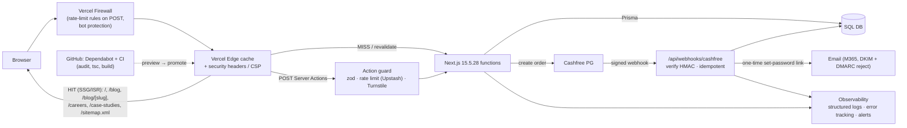

# Target architecture and roadmap

## Where the system is today

A fast edge (30 ms static responses) in front of an app that doesn't fully use it. Several content routes skip the cache, the server-rendered HTML is hidden until hydration, and the write path (five public Server Actions) has no visible validation, rate-limiting or abuse layer. Payment fulfilment is triggered by the browser. Details in [`REPORT.md`](../REPORT.md#3-observed-architecture).

## Target state

What changes, layer by layer:

| Layer | Today | Target | Recommendation |
|---|---|---|---|
| Dependencies | Next 15.5.18, 10 patches behind | 15.5.28 + Dependabot + CI gate | [`dependencies.md`](dependencies.md) |
| Edge | No security headers; dynamic content routes bypass cache | Headers + CSP on every response; content routes ISR | [`security-headers.md`](security-headers.md), [`rendering-and-caching.md`](rendering-and-caching.md) |
| Rendering | `<main>` hidden with `opacity:0` until hydration | Visible HTML, CSS-only entrance animation | [`rendering-and-caching.md`](rendering-and-caching.md#1-dont-hide-server-rendered-html) |
| Write API | 5 public actions, client-side checks only | One guard: schema → rate limit → Turnstile → `ActionResult` | [`server-actions.md`](server-actions.md) |
| Payments | Browser-triggered verify returns credentials | Signed webhook, atomic fulfilment, email link | [`payments.md`](payments.md) |
| Email | DMARC `none`, no DKIM | DKIM on, DMARC `reject` | [`email-and-privacy.md`](email-and-privacy.md) |
| Privacy | GA + ad signals before consent | Consent Mode v2, URL redaction | [`email-and-privacy.md`](email-and-privacy.md#3-analytics-consent-and-url-redaction) |
| Observability | Not visible from outside | See below | below |

## Observability (not verifiable from outside, recommended regardless)

Payments and lead capture are where silent failures cost money, so they need to be visible:
- **Structured logs:** one JSON line per action/webhook with `event`, `requestId` (`x-vercel-id` is already present on every response), `durationMs`, `outcome` and an error `code` from `ActionResult`. No emails, names or messages in logs.
- **Error tracking:** Sentry (or OpenTelemetry → any backend) via `instrumentation.ts`. Next.js calls `onRequestError` for Server Component, Route Handler and Server Action errors.
- **Alerts:** webhook signature failures > 0 in 5 min, `PENDING` orders older than 30 min (paid but not fulfilled), lead-action error rate > 5 %, `RATE_LIMITED` spikes (attack in progress).
- **Health:** a cheap `GET /api/health` that checks DB connectivity, watched by an uptime monitor.

## Prioritised roadmap

### Week 1: quick wins (each < ½ day, low risk)
| # | Change | Fixes | Effort |
|---|---|---|---|
| 1 | `next@15.5.28` + Dependabot | F-01 (High) | S |
| 2 | CSS-only page-enter animation (no `opacity:0`) | F-02 (High) | S |
| 3 | Icon font `icon_names` subset + `preconnect` | F-07 | S |
| 4 | Static security headers + `poweredByHeader: false` + CSP **Report-Only** | F-05, F-11 | S |
| 5 | GA4 redaction of `token`/`order_id`; Signals off | F-03 (partial), F-09 | S |
| 6 | DKIM on; DMARC `p=none` **with `rua`** | F-08 (start) | S |
| 7 | Apex redirect → 308; `metadataBase`; real sitemap dates | F-10 | S |
| 8 | `safeJsonLd` component; `Course` schema for BitElevate | F-13, F-14 | S |

### Weeks 2–3: structural fixes
| # | Change | Fixes | Effort |
|---|---|---|---|
| 9 | Cashfree webhook + idempotent fulfilment + set-password email; status-only verify; order in httpOnly cookie | F-03 | M |
| 10 | Action guard (zod caps, Upstash rate limit, Turnstile) + `ActionResult` on all 5 actions | F-04, F-12 | M |
| 11 | ISR for `/blog`, `/blog/[slug]`, `/case-studies`, `/careers`, `/sitemap.xml`; `dynamicParams = false`; `revalidatePath` on publish | F-06 | S–M |
| 12 | CSP Report-Only → enforced (after a week of clean reports) | F-05 | S |
| 13 | Self-host placeholder assets; image cache TTL | F-15 | S |

### Month 2: maturity
| # | Change | Why |
|---|---|---|
| 14 | DMARC `quarantine` → `reject` | finishes F-08 |
| 15 | Consent banner + Consent Mode v2 | finishes F-09 |
| 16 | Observability stack + alerts above | catch paid-but-not-enrolled and abuse early |
| 17 | HSTS `includeSubDomains; preload` after subdomain check; CAA; `security.txt` | finishes F-11 |
| 18 | Authenticated review of portal/admin (session cookies, token lifetime, server-side logout, `/admin` guards) | the areas this passive audit could not see ([§7](../REPORT.md#7-what-passive-testing-could-not-verify)) |

### Expected outcome (Week 1 + 2–3)
- **Security:** no known framework advisories; clickjacking and the most common injection paths closed; payment credentials never in the browser; write endpoints rate-limited.
- **Performance:** mobile FCP from ~9 s toward ~1–2 s (no hidden HTML, a ~15 KB icon font instead of 1.1 MB); home page ~1.7 MB → ~0.6 MB; content routes from 500–850 ms to edge-cache speed. These are estimates; re-measure with the same Lighthouse/curl commands in [`PLAN.md`](../PLAN.md) after each change.
- **Reliability:** every paid order is fulfilled exactly once, even if the user closes the tab.
