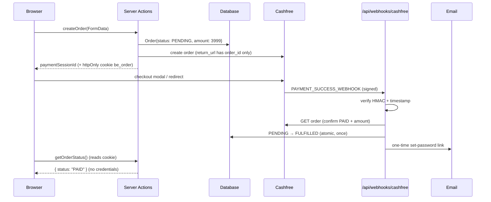

# Payments: server-driven fulfilment for BitElevate (F-03)

## Problem
Today (reconstructed from client code, [`evidence/1.6-bundle-notes.md`](../evidence/1.6-bundle-notes.md)):
1. `createBitelevateCashfreeOrder` returns `orderId` + `token` to the browser.
2. After checkout, the **browser** calls `verifyBitelevatePayment(token, orderId)`, either directly or from the return URL `?order_id=…&token=…`.
3. On success the action returns **`bitElevateCredentials`**, which the page displays.

Risks: credentials can be retrieved again by anyone holding the URL (if verify is repeatable); GA4 receives the token in `page_location`; and an enrolment is lost if the browser never makes the verify call.

What's already right and should stay: the amount is decided server-side, and success is checked against Cashfree's order status rather than trusted from the client.

## Target flow



Three rules:
1. **The webhook is the source of truth.** The browser only *asks* for status.
2. **Fulfilment is idempotent.** Cashfree retries webhooks, and users refresh pages.
3. **Credentials never travel through the browser.** Access is delivered by email as a one-time, expiring link.

## 1. Webhook route

```ts
// app/api/webhooks/cashfree/route.ts
import { verifyCashfreeSignature } from '@/lib/security'; // = recommendations/code/lib.ts (tested)
import { fulfilOrder } from '@/lib/bitelevate/fulfil';

export const runtime = 'nodejs'; // node:crypto + Prisma

export async function POST(req: Request) {
  const secret = process.env.CASHFREE_CLIENT_SECRET;
  if (!secret) return problem(500, 'Server misconfigured');

  const raw = await req.text(); // raw body: the signature covers exact bytes, never re-serialise
  const signature = req.headers.get('x-webhook-signature') ?? '';
  const timestamp = req.headers.get('x-webhook-timestamp') ?? '';
  if (!verifyCashfreeSignature(raw, timestamp, signature, secret)) return problem(401, 'Invalid signature');

  const event = JSON.parse(raw) as { type: string; data?: { order?: { order_id?: string } } };
  const orderId = event.data?.order?.order_id;
  if (event.type !== 'PAYMENT_SUCCESS_WEBHOOK' || !orderId) return new Response(null, { status: 204 });

  await fulfilOrder(orderId);               // safe to call any number of times
  return new Response(null, { status: 200 }); // 2xx stops Cashfree retries
}

function problem(status: number, title: string) {
  return Response.json({ type: 'about:blank', title, status }, {
    status, headers: { 'Content-Type': 'application/problem+json' },
  });
}
```
`verifyCashfreeSignature` checks `base64(HMAC-SHA256(timestamp + rawBody, secret))` in constant time and rejects timestamps older than 5 minutes (replay protection). Its tests are in [`code/lib.test.ts`](code/lib.test.ts). If the project already uses the official `cashfree-pg` SDK, its `PGVerifyWebhookSignature` does the same check. Configure the webhook URL in the Cashfree dashboard and confirm the header names for the API version in use.

## 2. Idempotent fulfilment

```ts
// lib/bitelevate/fulfil.ts (model names are illustrative)
import { randomBytes, createHash } from 'node:crypto';
import { prisma } from '@/lib/prisma';
import { getCashfreeOrder } from '@/lib/cashfree';
import { sendSetPasswordEmail } from '@/lib/email';

const EXPECTED_AMOUNT = 3999;

export async function fulfilOrder(orderId: string): Promise<void> {
  // Defence in depth: never trust the webhook body alone for money; ask Cashfree.
  const cf = await getCashfreeOrder(orderId); // GET /pg/orders/{order_id}
  if (cf.order_status !== 'PAID' || cf.order_amount !== EXPECTED_AMOUNT) return;

  const raw = randomBytes(32).toString('base64url');
  const sent = await prisma.$transaction(async (tx) => {
    // Atomic compare-and-set: only one concurrent caller moves PENDING → FULFILLED.
    const { count } = await tx.order.updateMany({
      where: { orderId, status: 'PENDING' },
      data: { status: 'FULFILLED', paidAt: new Date() },
    });
    if (count === 0) return null; // already fulfilled (webhook retry / duplicate)

    const order = await tx.order.findUniqueOrThrow({ where: { orderId } });
    const user = await tx.user.upsert({
      where: { email: order.email },
      create: { email: order.email, name: order.fullName }, // no password yet
      update: {},
    });
    await tx.passwordSetupToken.create({
      data: {
        userId: user.id,
        tokenHash: createHash('sha256').update(raw).digest('hex'), // store the hash, never the token
        expiresAt: new Date(Date.now() + 24 * 60 * 60 * 1000),
      },
    });
    return order.email;
  });

  if (sent) await sendSetPasswordEmail(sent, `https://bitelevate.cynbit.in/set-password#token=${raw}`);
}
```
- `updateMany … where status = 'PENDING'` is the idempotency guard. Duplicates and concurrent retries become no-ops without a separate lock.
- The token goes in the **URL fragment** (`#token=`). Fragments are never sent to servers or analytics. The set-password page reads it, posts it once, and the server deletes the row.
- Email is sent **after** the commit. If sending fails, the order is still fulfilled; let a "resend access email" action handle it.

## 3. Order creation and status: nothing secret in the URL

```ts
// app/(marketing)/bitelevate/actions.ts (excerpt)
'use server';
import { cookies } from 'next/headers';
import { randomUUID } from 'node:crypto';

export async function createBitelevateOrder(formData: FormData) {
  // …zod validation + rate limit + Turnstile (see server-actions.md)
  const orderId = `be_${randomUUID()}`;
  // …DB insert {orderId, status: 'PENDING', amount: 3999, email, …}
  // …Cashfree create order with:
  //    order_meta.return_url = `https://www.cynbit.in/bitelevate?order_id={order_id}`   ← no token
  //    order_meta.notify_url = `https://www.cynbit.in/api/webhooks/cashfree`
  (await cookies()).set('be_order', orderId, {
    httpOnly: true, secure: true, sameSite: 'lax', path: '/bitelevate', maxAge: 60 * 60,
  });
  return { ok: true as const, data: { paymentSessionId: '…' } };
}

export async function getBitelevateOrderStatus() {
  const orderId = (await cookies()).get('be_order')?.value;
  if (!orderId) return { ok: false as const, code: 'VALIDATION' as const, message: 'No order in progress' };
  const order = await prisma.order.findUnique({ where: { orderId }, select: { status: true } });
  return { ok: true as const, data: { status: order?.status ?? 'UNKNOWN' } }; // status only, no credentials
}
```
The client polls `getBitelevateOrderStatus()` for a few seconds after checkout and shows "Paid. Check your email for your login link". Because the order is bound to an httpOnly cookie, a copied URL reveals nothing. On the return page, remove the query string immediately: `history.replaceState(null, '', location.pathname)`.

## 4. Analytics
In **GA4 Admin → Data streams → Web → Redact data**, add the query parameters `token` and `order_id`. This also covers URLs that were already shared. See also [`email-and-privacy.md`](email-and-privacy.md).

## How to verify (Cashfree sandbox)
1. Pay a sandbox order, close the tab before the modal returns: the webhook still enrols the user and sends the email.
2. Replay the same webhook (same body + headers) after 6 minutes → `401`. Replay within the window → `200`, but `count === 0`, so no second email.
3. Change one byte of the body → `401`.
4. `getBitelevateOrderStatus` from another browser (no cookie) → no data.
5. GA4 DebugView: `page_location` contains no `token`.
